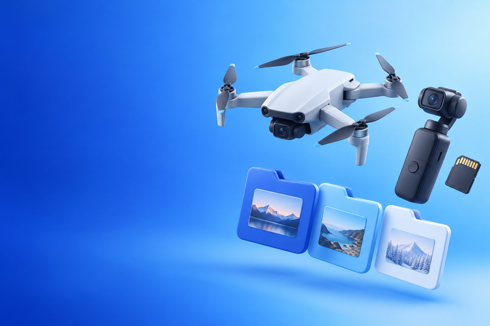
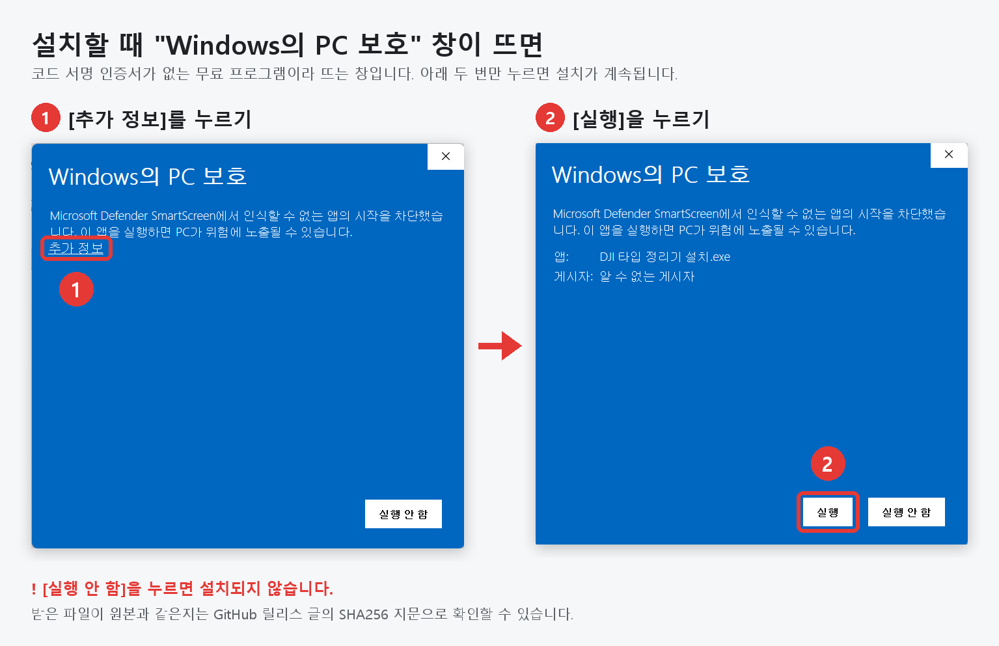

# DJI 타입 정리기



DJI 카메라·드론으로 찍은 영상과 사진을 **촬영일별 폴더**로 정리하는 Windows용 무료 프로그램입니다.
폴더를 창에 끌어다 놓고 [정리 시작]만 누르면 됩니다.

> [!NOTE]
> **DJI가 만든 정식 프로그램이 아닙니다.** 개인(이중필름)이 만든 비공식 무료 프로그램이며 DJI와는 관련이 없습니다.
> 'DJI 타입'은 DJI 카메라·드론이 만드는 카드 구조(파일)를 정리한다는 뜻입니다. 1.2까지의 이름은 **DJI정리툴**입니다.

> 1.3 · 만든 사람: 이중필름 (유튜브 채널 **[이중필름](https://www.youtube.com/@2J_FILM)**) · 문의: nasunfilm@gmail.com · 비영리 무료 배포 · DJI는 SZ DJI Technology Co., Ltd.의 상표입니다.

> [!WARNING]
> **반드시 원본을 복사한 뒤, 복사한 폴더를 정리하세요.**
> 이 프로그램은 PC로 복사해 둔 데이터를 정리하도록 만들었으며, SD카드나 유일한 원본을 바로 정리하는 방식은 고려하지 않았습니다.
> 테스트를 거쳐 안전하다고 판단해 배포하지만, PC 환경(백신·동기화 프로그램·저장 장치 등)에 따라 예상하지 못한 문제가 생길 수 있습니다.
> 원본 카드나 백업본은 정리가 끝나고 결과를 확인할 때까지 지우거나 포맷하지 마세요.

## 내려받기 · 설치

[Releases](https://github.com/musiqsb-svg/dji-sort-tool/releases)에서 **`DJISortTool-1.3.zip` 하나만** 받으면 됩니다. 압축을 풀면 세 파일뿐입니다.

| 파일 | 하는 일 |
|---|---|
| **DJI 타입 정리기 설치.exe** | 실행하고 [설치하기] 한 번. 이전 버전이 있으면 그대로 업데이트 (설정·기록 유지) |
| **DJI 타입 정리기 제거.exe** | 실행하고 [제거하기] 한 번. [설정 › 앱]에서 제거하는 것과 같음 |
| 사용 안내.txt | 설치·사용·제거 안내 |

- Windows 10/11. 관리자 권한 없이 지금 사용자 계정에만 설치됩니다 (`%LOCALAPPDATA%\Programs\DJISortTool`).
- 설치하면: 시작 메뉴, 바탕화면 아이콘(선택), 폴더 우클릭 **DJI 타입 정리기로 정리**(선택), [설정 › 앱]의 제거 항목
- 제거하면: 위 항목과 설정·옮긴 기록(`%LOCALAPPDATA%\DJISortTool`)을 지웁니다. **정리한 영상·사진 폴더는 그대로**입니다.
- 1.2까지의 DJI정리툴(Inno Setup으로 설치한 버전) 위에도 그대로 설치됩니다. 먼저 지울 필요가 없습니다.

> [!IMPORTANT]
> **설치 파일을 열 때 파란 "Windows의 PC 보호" 창이 뜨면 → ① [추가 정보] → ② [실행]**
>
> 코드 서명 인증서(유료)가 없는 무료 프로그램이라 Windows가 띄우는 창입니다. 처음 보이는 화면에는 [실행 안 함]만 있으니,
> 그 위의 **[추가 정보]** 글자를 누르면 나타나는 **[실행]** 버튼을 누르세요. [실행 안 함]을 누르면 설치되지 않습니다.
> 받은 파일이 원본과 같은지는 릴리스 글의 SHA256 지문으로 확인할 수 있습니다.



## 정리 결과

```
넣은 폴더
├ 260823_DATA_34.1G                  ← 폴더 이름 끝에 용량 (옵션, 기본으로 켜짐)
│  ├ 260823_Footage    원본 영상      DJI_20260823135545_0039_D.MP4
│  ├ 260823_Proxy      프록시         DJI_20260823135545_0039_D_Proxy.MP4   ← .LRF
│  ├ 260823_Audio      오디오         DJI_20260823135545_0039_D.AAC
│  └ 260823_Photo
│     ├ jpg
│     └ dng
└ 260825_DATA_412M …
```

- **촬영일**은 파일명에 들어 있는 녹화 시작 시각(`DJI_20260823135545_…`)으로 정합니다. 카드에서 복사해도 바뀌지 않습니다.
- **LRF**(DJI 미리보기 파일)는 `원본이름_Proxy.MP4`로 이름을 바꿉니다. 해상도만 낮고 프레임·길이·오디오는 원본과 같아서 Premiere에서 그대로 프록시로 연결할 수 있습니다.
- **AAC**(오디오 분리 녹음)는 Audio 폴더에 따로 모읍니다. 영상 폴더를 통째로 가져와도 클립이 두 배로 보이지 않습니다.
- 슬로모션·타임랩스처럼 LRF가 생기지 않는 영상은 미리보기에서 알려 줍니다.
- **폴더 이름 끝 용량**(`_34.1G`, 1GB 미만은 `_412M`)은 탐색기 속성 창과 같은 1024 기준, 소수점 한 자리 내림입니다.
  카드를 포맷한 뒤에도 NAS·외장하드 백업본과 용량을 비교할 수 있습니다.
  같은 날짜를 나중에 같은 폴더에 추가로 정리하면 기존 폴더에 합치고 용량을 새로 고칩니다.

> **Premiere 사용 시**: 용량 표기가 켜져 있으면 폴더 이름이 바뀝니다. 정리를 마친 뒤에 Premiere로 가져오세요.
> 이미 가져온 날짜를 추가로 정리하면 폴더 이름이 바뀌어 링크를 다시 연결해야 합니다.

## 사용법

1. SD카드 내용을 PC 폴더로 **복사**합니다. (카드 통째, DCIM 폴더만, 영상 파일만 — 모두 됩니다) 원본은 그대로 둡니다.
2. DJI 타입 정리기를 열고 그 폴더를 창에 끌어다 놓습니다. (또는 [폴더 선택…])
   폴더를 우클릭해 **DJI 타입 정리기로 정리**를 눌러도 됩니다. (Windows 11은 '더 많은 옵션 표시' 안에 있음)
3. 미리보기를 확인하고 [정리 시작]을 누릅니다.
4. 마음에 들지 않으면 [되돌리기]로 원래대로 돌릴 수 있습니다.

## 안전장치

- **파일을 지우지 않습니다.** 넣은 폴더 안에서 옮기기만 하므로 용량과 상관없이 바로 끝나고, 되돌릴 수 있습니다.
- **같은 이름의 파일이 있으면 덮어쓰지 않고** 건너뜁니다.
- **정리가 끝나면 확인합니다.** 옮긴 파일이 모두 제자리에 정리 전과 같은 크기로 있는지 하나씩 대조해 결과에 표시합니다.
- **SD카드에서 바로 정리하지 않습니다.** 복사본 없이 카드 파일을 옮기게 되므로, PC로 복사한 뒤 쓰도록 안내합니다.
- 정리 규칙이 없는 파일(드론 비행기록 SRT, 360 영상 OSV 등)은 그대로 둡니다.
- 정리 후 남는 카드 관리 파일(썸네일·목록, `MISC` 폴더)은 휴지통으로 보낼 수 있습니다(옵션). 다른 파일이 섞여 있으면 보내지 않고, 결과에 그 파일을 알려 줍니다.
- 탐색기·Mac·NAS가 만드는 찌꺼기(`Thumbs.db`, `desktop.ini`, `.DS_Store`, `._파일이름`, `@eaDir`)는 정리 대상으로 세지 않고,
  이것만 남은 폴더는 찌꺼기와 함께 지웁니다 (이것 때문에 `DCIM` 등이 남지 않게)
- 인터넷에 연결하지 않으며 어떤 정보도 수집하지 않습니다. 설정과 옮긴 기록만 `%LOCALAPPDATA%\DJISortTool`에 저장합니다.
- 예상하지 못한 오류가 나면 내용을 같은 곳의 `logs\error_….txt`에 남깁니다 (문의할 때 첨부)

## 1.3에서 바뀐 점

- **이름을 'DJI 타입 정리기'로 바꿈** (예전 이름: DJI정리툴). DJI가 만든 정식 프로그램이 아니라는 점을 분명히 하려고,
  화면·설치 프로그램에도 "DJI 정식 프로그램이 아닙니다"를 표시합니다. DJI정리툴 설치본 위에 그대로 업데이트되고, 옛 이름의 바로가기는 새 이름으로 바뀝니다
- 소니 카드 폴더를 넣으면 SONY 타입 정리기를 쓰라고 알려 줌
- **배포를 zip 하나로**: 압축을 풀면 '설치'·'제거'·'사용 안내' 세 파일뿐입니다. 소스 코드·Portable·지문 파일은 zip에서 뺐습니다 (소스는 이 저장소, 지문은 릴리스 글)
- **원클릭 설치·제거**: Inno Setup 대신 직접 만든 설치 프로그램. [설치하기] 한 번으로 설치·업데이트, [제거하기] 한 번으로 제거. 1.2 설치본도 그대로 이어받음
- **화면 새 디자인**: 끌어다 놓는 곳 그림, 폴더를 넣으면 작아져 표가 넓어지는 구역, 날짜별 표, 켜고 끄는 스위치, 결과 요약 카드
- 정리 후 `DCIM` 등이 남던 문제 수정: 탐색기·Mac·NAS·Dropbox가 카드에 남기는 찌꺼기 파일을 빈 폴더로 봄 (SONY 타입 정리기 · 옛 소니정리툴 1.3과 같은 처리)
- 카드 관리 폴더(`MISC`)를 휴지통으로 못 보냈을 때 '다른 파일이 섞여 있음'과 '다른 프로그램이 사용 중'을 나눠 알리고, 남긴 이유가 된 파일을 보여 줌.
  잠깐 잡혀 있던 경우는 몇 번 다시 시도
- 정리·되돌리기 뒤 탐색기 창을 새로 고침 (지운 폴더·바뀌기 전 이름이 계속 보이지 않게)
- 파일을 하나도 못 옮긴 날짜는 빈 날짜 폴더를 남기지 않음
- 작은 화면(노트북 150% 배율 등)에서도 창이 화면을 넘지 않게, 예상하지 못한 오류 내용을 기록 폴더에 저장

## 직접 빌드하기

Windows 10/11에 기본으로 들어 있는 C# 컴파일러(.NET Framework 4.x)만 씁니다. 설치 프로그램도 직접 만들므로 따로 설치할 것이 없습니다.

```
powershell -ExecutionPolicy Bypass -File build.ps1 -Test
```

- `dist\DJISortTool.exe` — 프로그램 (설치 없이도 바로 실행됨)
- `dist\Setup.exe` · `dist\Uninstall.exe` — 설치·제거 프로그램 (배포 이름: `DJI 타입 정리기 설치.exe` · `DJI 타입 정리기 제거.exe`)
- `build\OrganizerTest.exe` — 정리 로직 테스트 (`--replica <폴더>`로 실제 폴더를 1바이트 복제본으로 시험)
- `tests\SetupTest.ps1` — 설치·제거 테스트. 새로 설치·다시 설치·1.2 이전 설치본 업데이트·실행 중 막기·제거를
  임시 폴더와 별도 레지스트리 키(`/sandbox`)에서만 해 보므로 이 PC에 설치된 DJI 타입 정리기(옛 DJI정리툴)는 건드리지 않음

배포 파일까지 만들려면 `-Release`를 붙입니다 (버전은 `src\Product.cs`의 `Version`과 `src\app.manifest` 두 곳).

```
powershell -ExecutionPolicy Bypass -File build.ps1 -Release
```

```
release\
├ DJISortTool-1.3.zip       ← 이것 하나만 배포 (GitHub 릴리스에 그대로 올림)
│   ├ DJI 타입 정리기 설치.exe
│   ├ DJI 타입 정리기 제거.exe
│   └ 사용 안내.txt
└ SHA256.txt                ← 릴리스 글에 붙일 파일 지문
```

| 파일 | 내용 |
|---|---|
| `src\Organizer.cs` | 정리 로직 (미리보기·정리·되돌리기) |
| `src\MainForm.cs` | 화면 |
| `src\Ui.cs` | 화면 공통 부품 (둥근 버튼·토글·진행 막대·카드·머리 그림). 설치·제거 프로그램도 함께 씀 |
| `src\Product.cs` | 이름·버전·색 등 제품 정보 (한 곳에서 관리) |
| `src\FolderPicker.cs` | 탐색기 모양 폴더 선택 창 |
| `src\Settings.cs` | 설정 저장 |
| `setup\Setup.cs` | 설치·제거 프로그램 (같은 소스로 두 파일을 만듦) |
| `setup\guide.txt` | 배포 zip의 `사용 안내.txt` |
| `assets\make_icon.ps1` | 아이콘 (프로그램 · 설치 ↓ · 제거 ×) |
| `assets\art\` | Codex 이미지 생성으로 만든 그림 (설치 화면 · 끌어다 놓는 곳). 프롬프트는 `assets\art\prompts.md` |
| `assets\guide\` | README 안내 그림 ("Windows의 PC 보호" 창 대응) |

## 문의

- 만든 사람: 이중필름 (유튜브 채널 **[이중필름](https://www.youtube.com/@2J_FILM)**)
- 문의·오류 제보: nasunfilm@gmail.com — 정리하려던 폴더 구조와 결과 화면을 함께 보내 주시면 빨리 확인할 수 있습니다.

## 라이선스

MIT 라이선스 — 자유롭게 쓰고 고치고 나눌 수 있습니다. 자세한 내용은 [LICENSE](LICENSE)를 보세요.
© 2026 이중필름
